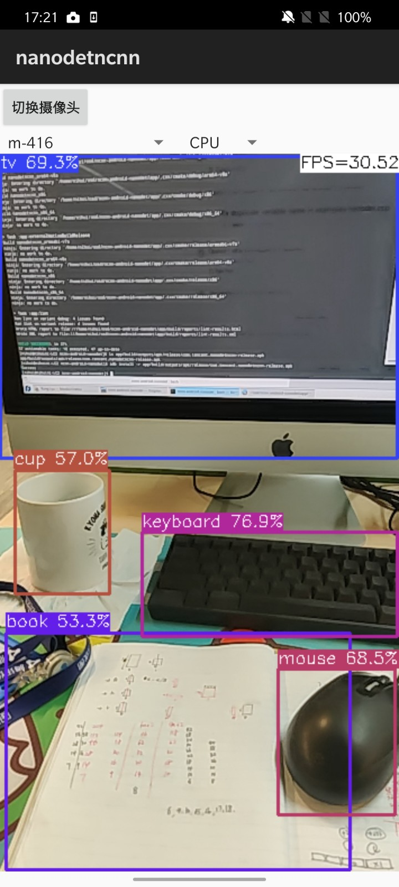

# ncnn-android-nanodet

The NanoDet object detection

This is a sample ncnn android project, it depends on ncnn library and opencv

https://github.com/Tencent/ncnn

https://github.com/nihui/opencv-mobile

https://github.com/nihui/mesa-turnip-android-driver  (mesa turnip driver)

https://github.com/nihui/momoten  (momoten driver)

## android apk file download
https://github.com/nihui/ncnn-android-nanodet/releases/latest

## how to build and run
### step1
https://github.com/Tencent/ncnn/releases

* Download ncnn-YYYYMMDD-android-vulkan.zip or build ncnn for android yourself
* Extract ncnn-YYYYMMDD-android-vulkan.zip into **app/src/main/jni** and change the **ncnn_DIR** path to yours in **app/src/main/jni/CMakeLists.txt**

### step2
https://github.com/nihui/opencv-mobile

* Download opencv-mobile-XYZ-android.zip
* Extract opencv-mobile-XYZ-android.zip into **app/src/main/jni** and change the **OpenCV_DIR** path to yours in **app/src/main/jni/CMakeLists.txt**

### step3
https://github.com/nihui/mesa-turnip-android-driver

* Download mesa-turnip-android-XYZ.zip
* Create directory **app/src/main/jniLibs/arm64-v8a** if not exists
* Extract `libvulkan_freedreno.so` from mesa-turnip-android-XYZ.zip into **app/src/main/jniLibs/arm64-v8a**

### step4
https://github.com/nihui/momoten/releases/latest

* Download `momoten-YYYYMMDD-android-<target>.zip` for `arm64-v8a-api21`, `armeabi-v7a-api14`, `x86-api14` and `x86_64-api21`
* Extract `lib/libmomoten.so` into `app/src/main/jniLibs/<abi>` for each corresponding ABI (create directories if needed)
* Select **momoten** in the CPU/GPU selector; a usable vendor OpenCL driver is required

### step5
* Open this project with Android Studio, build it and enjoy!

## some notes
* Android 5.0 (API 21) or newer is required
* NDK Camera is preferred, with Camera1 used on older Android versions and legacy devices
* All models are manually modified to accept dynamic input shape
* Most small models run slower on GPU than on CPU, this is common
* FPS may be lower in dark environment because of longer camera exposure time

## screenshot

